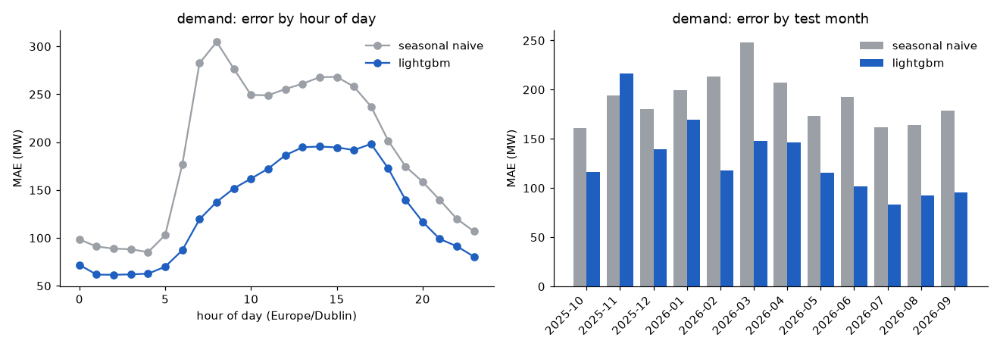
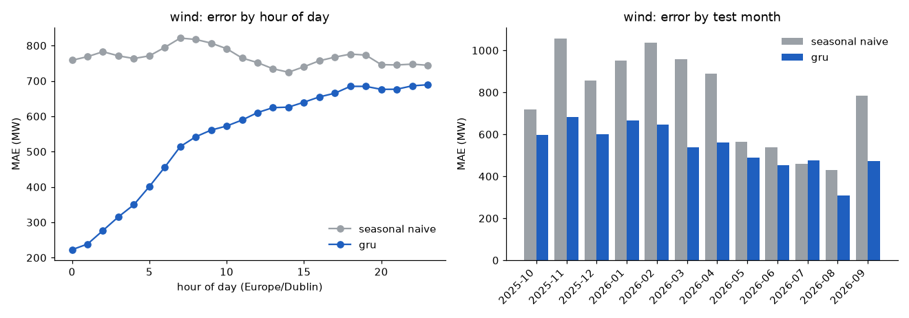
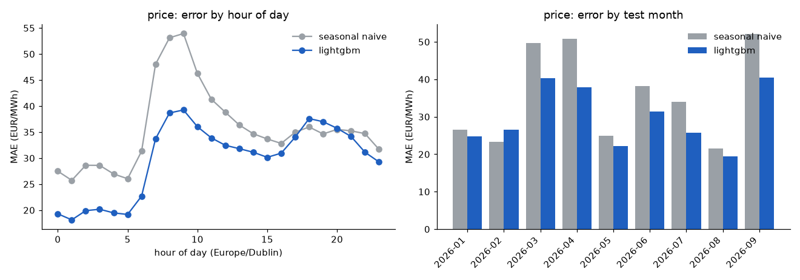

# grid-forecast

Day-ahead forecasts of Irish system demand, wind generation and the SEM day-ahead price on one year of public hourly data, with two baselines, LightGBM and a small GRU, scored on monthly walk-forward folds, logged to MLflow, and served from the model registry behind a FastAPI endpoint. The question it answers is plain: on twelve months of hourly data, how much do the learned models beat the seasonal naive, and in which hours do they fail.

This is one year of hourly data for one small system (about 8,800 hours per series). It is a complete, reproducible forecasting exercise, not a large one.

Supported by EirGrid Group Data.

## Results

Every block between marker comments in this file is regenerated from `results/*.json` by `python -m grid_forecast run` (or by `python -m grid_forecast readme` without training anything). The smoke run checks that this README carries every number a fresh render of the results files produces, and `tests/test_readme_numbers.py` asserts the same. Mean absolute error is the mean over folds of the per-fold MAE. Skill is 1 minus the model MAE divided by the seasonal-naive MAE, so a positive skill means the model beat "same hour yesterday". Units: MW for demand and wind, EUR/MWh for the price.

<!-- results:start -->
| Series | Period | Folds | Seasonal-naive MAE | Last-week MAE | LightGBM MAE | GRU MAE | Best skill vs seasonal naive | Folds with positive skill | Worst hour of day (MAE) | Champion |
|---|---|---|---|---|---|---|---|---|---|---|
| demand (MW) | Oct 2025 to Sep 2026 | 12 | 189.5 MW | 162.1 MW | 128.4 MW | 175.0 MW | +32.4 % | 11 of 12 | 17:00 (198.2 MW) | lightgbm |
| wind (MW) | Oct 2025 to Sep 2026 | 12 | 770.1 MW | 941.5 MW | 554.8 MW | 540.6 MW | +27.0 % | 11 of 12 | 23:00 (689.1 MW) | gru |
| price (EUR/MWh) | Jan to Sep 2026 (data from Oct 2025) | 9 | 35.7 EUR/MWh | 41.1 EUR/MWh | 29.9 EUR/MWh | 30.7 EUR/MWh | +13.5 % | 8 of 9 | 09:00 (39.3 EUR/MWh) | lightgbm |
<!-- results:end -->

Mean fold RMSE of the same models, and the mean fold MAPE where it is defined:

<!-- rmse:start -->
| Series | Seasonal-naive RMSE | Last-week RMSE | LightGBM RMSE | GRU RMSE | MAPE (LightGBM / GRU) |
|---|---|---|---|---|---|
| demand (MW) | 264.9 MW | 224.7 MW | 177.2 MW | 221.1 MW | 3.07 % / 4.21 % |
| wind (MW) | 974.0 MW | 1,156.0 MW | 712.9 MW | 687.5 MW | not defined (values can be zero or negative) |
| price (EUR/MWh) | 48.9 EUR/MWh | 55.4 EUR/MWh | 40.4 EUR/MWh | 40.7 EUR/MWh | not defined (values can be zero or negative) |
<!-- rmse:end -->

The per-fold numbers behind the means (MAE and RMSE of every model on every fold, skill of the two learned models):

<!-- folds:start -->
<details><summary>Per-fold MAE and RMSE, demand (MW)</summary>

| Fold | Test month | Training months | Seasonal naive MAE / RMSE | Last week MAE / RMSE | LightGBM MAE / RMSE | GRU MAE / RMSE | LightGBM skill | GRU skill |
|---|---|---|---|---|---|---|---|---|
| 1 | October 2025 | 3 | 161.3 / 234.2 | 131.2 / 187.2 | 116.0 / 162.1 | 173.0 / 223.7 | +28.1 % | -7.3 % |
| 2 | November 2025 | 4 | 193.9 / 273.7 | 190.9 / 237.5 | 216.2 / 291.5 | 227.6 / 280.6 | -11.5 % | -17.4 % |
| 3 | December 2025 | 5 | 180.6 / 245.4 | 185.3 / 277.6 | 139.2 / 203.1 | 189.5 / 241.4 | +22.9 % | -4.9 % |
| 4 | January 2026 | 6 | 199.5 / 280.6 | 245.9 / 358.0 | 169.4 / 238.3 | 412.9 / 451.7 | +15.1 % | -107.0 % |
| 5 | February 2026 | 7 | 213.1 / 297.8 | 178.7 / 237.4 | 118.1 / 159.0 | 116.6 / 164.5 | +44.6 % | +45.3 % |
| 6 | March 2026 | 8 | 247.9 / 328.5 | 176.9 / 253.5 | 148.0 / 197.6 | 196.9 / 265.4 | +40.3 % | +20.6 % |
| 7 | April 2026 | 9 | 207.4 / 282.2 | 193.0 / 257.9 | 146.5 / 190.9 | 199.5 / 254.5 | +29.3 % | +3.8 % |
| 8 | May 2026 | 10 | 173.1 / 253.0 | 169.4 / 232.3 | 115.4 / 158.5 | 159.4 / 201.3 | +33.3 % | +7.9 % |
| 9 | June 2026 | 11 | 192.4 / 281.0 | 122.3 / 175.6 | 101.3 / 141.9 | 114.7 / 150.4 | +47.3 % | +40.4 % |
| 10 | July 2026 | 12 | 162.0 / 231.4 | 108.4 / 146.0 | 83.3 / 116.6 | 111.3 / 147.9 | +48.6 % | +31.3 % |
| 11 | August 2026 | 13 | 164.4 / 219.1 | 152.1 / 201.2 | 92.3 / 125.8 | 89.8 / 122.6 | +43.8 % | +45.3 % |
| 12 | September 2026 | 14 | 178.8 / 251.2 | 91.1 / 132.3 | 95.4 / 141.4 | 108.9 / 149.1 | +46.7 % | +39.1 % |

</details>

<details><summary>Per-fold MAE and RMSE, wind (MW)</summary>

| Fold | Test month | Training months | Seasonal naive MAE / RMSE | Last week MAE / RMSE | LightGBM MAE / RMSE | GRU MAE / RMSE | LightGBM skill | GRU skill |
|---|---|---|---|---|---|---|---|---|
| 1 | October 2025 | 3 | 717.9 / 946.9 | 1,217.0 / 1,439.7 | 605.4 / 820.6 | 596.8 / 804.5 | +15.7 % | +16.9 % |
| 2 | November 2025 | 4 | 1,056.1 / 1,265.1 | 1,100.5 / 1,361.6 | 713.2 / 882.7 | 681.0 / 839.6 | +32.5 % | +35.5 % |
| 3 | December 2025 | 5 | 855.8 / 1,139.2 | 1,021.2 / 1,257.5 | 698.1 / 880.0 | 601.7 / 773.9 | +18.4 % | +29.7 % |
| 4 | January 2026 | 6 | 950.2 / 1,200.0 | 1,121.4 / 1,394.9 | 758.6 / 926.3 | 664.9 / 820.8 | +20.2 % | +30.0 % |
| 5 | February 2026 | 7 | 1,035.3 / 1,295.7 | 1,061.4 / 1,362.9 | 714.5 / 895.5 | 644.8 / 814.2 | +31.0 % | +37.7 % |
| 6 | March 2026 | 8 | 957.5 / 1,189.8 | 1,289.0 / 1,487.9 | 604.3 / 766.2 | 537.6 / 688.0 | +36.9 % | +43.9 % |
| 7 | April 2026 | 9 | 890.5 / 1,107.9 | 927.4 / 1,112.6 | 597.8 / 810.2 | 560.7 / 765.4 | +32.9 % | +37.0 % |
| 8 | May 2026 | 10 | 564.3 / 737.2 | 776.0 / 987.5 | 411.0 / 512.3 | 490.4 / 590.7 | +27.2 % | +13.1 % |
| 9 | June 2026 | 11 | 538.0 / 677.8 | 797.3 / 952.4 | 380.5 / 524.9 | 451.5 / 601.0 | +29.3 % | +16.1 % |
| 10 | July 2026 | 12 | 460.5 / 593.0 | 492.9 / 670.3 | 376.7 / 496.2 | 475.6 / 564.2 | +18.2 % | -3.3 % |
| 11 | August 2026 | 13 | 430.8 / 554.7 | 579.5 / 714.0 | 296.2 / 405.0 | 309.5 / 392.8 | +31.2 % | +28.2 % |
| 12 | September 2026 | 14 | 784.0 / 980.5 | 914.7 / 1,130.2 | 501.2 / 634.5 | 473.2 / 594.9 | +36.1 % | +39.6 % |

</details>

<details><summary>Per-fold MAE and RMSE, price (EUR/MWh)</summary>

| Fold | Test month | Training months | Seasonal naive MAE / RMSE | Last week MAE / RMSE | LightGBM MAE / RMSE | GRU MAE / RMSE | LightGBM skill | GRU skill |
|---|---|---|---|---|---|---|---|---|
| 1 | January 2026 | 3 | 26.5 / 37.6 | 33.2 / 46.3 | 24.8 / 34.9 | 26.3 / 34.6 | +6.7 % | +0.9 % |
| 2 | February 2026 | 4 | 23.3 / 31.8 | 29.4 / 41.3 | 26.5 / 33.8 | 28.1 / 34.9 | -14.0 % | -21.0 % |
| 3 | March 2026 | 5 | 49.8 / 64.3 | 65.7 / 81.2 | 40.3 / 52.5 | 40.4 / 51.6 | +19.0 % | +18.8 % |
| 4 | April 2026 | 6 | 50.8 / 66.0 | 52.8 / 69.5 | 37.9 / 49.6 | 39.2 / 51.5 | +25.4 % | +22.8 % |
| 5 | May 2026 | 7 | 24.9 / 35.8 | 34.4 / 44.2 | 22.3 / 28.9 | 24.4 / 31.8 | +10.5 % | +2.0 % |
| 6 | June 2026 | 8 | 38.3 / 52.4 | 40.6 / 55.0 | 31.4 / 44.8 | 29.0 / 40.5 | +17.9 % | +24.1 % |
| 7 | July 2026 | 9 | 34.0 / 44.0 | 32.2 / 46.9 | 25.7 / 33.9 | 24.8 / 34.4 | +24.4 % | +27.1 % |
| 8 | August 2026 | 10 | 21.5 / 32.0 | 26.9 / 38.9 | 19.4 / 28.0 | 21.3 / 30.7 | +9.7 % | +1.2 % |
| 9 | September 2026 | 11 | 52.1 / 75.9 | 54.8 / 75.6 | 40.5 / 57.1 | 43.0 / 56.0 | +22.3 % | +17.5 % |

</details>
<!-- folds:end -->

### The hours where the models fail

For the champion of each series, the 5 % of scored test hours with the largest absolute error, tagged with every reason that applies. Each cell is the share of failure hours carrying the tag next to the share of all scored hours carrying it, so a tag that is enriched among the failures stands out. The full rows are in `results/worst_hours_<series>.json` and the plots in `docs/failures_<series>.png`.

<!-- failures:start -->
| Series | Failure hours (worst 5 %) | Error threshold | Holiday share (failures / all hours) | Clock-change share | Wind-ramp share | Price-spike share | Negative-price share | Interpolated-input share | Evening-peak share | Morning-ramp share |
|---|---|---|---|---|---|---|---|---|---|---|
| demand | 438 of 8760 | 384.2 MW | 8.4 % / 2.7 % | 0.0 % / 0.5 % | 7.3 % / 5.6 % | 8.2 % / 5.0 % | 0.0 % / 0.3 % | 0.0 % / 0.0 % | 24.9 % / 16.7 % | 16.2 % / 16.7 % |
| wind | 438 of 8760 | 1,414.1 MW | 6.2 % / 2.7 % | 2.1 % / 0.5 % | 11.4 % / 5.6 % | 5.9 % / 5.0 % | 0.7 % / 0.3 % | 0.0 % / 0.0 % | 29.9 % / 16.7 % | 11.2 % / 16.7 % |
| price | 328 of 6552 | 88.7 EUR/MWh | 1.8 % / 2.6 % | 2.1 % / 0.4 % | 6.7 % / 5.3 % | 35.4 % / 5.1 % | 1.2 % / 0.1 % | 0.0 % / 0.0 % | 22.9 % / 16.7 % | 22.6 % / 16.7 % |
<!-- failures:end -->

<!-- reading:start -->
### Reading the results

**Demand.** LightGBM is the champion: a mean fold MAE of 128.4 MW against 189.5 MW for the seasonal naive and 162.1 MW for last week, a skill of +32.4 %, positive on 11 of 12 folds. It loses to the naive in November 2025 (216.2 MW against 193.9 MW). The GRU averages 175.0 MW, is positive on 8 of 12 folds, and is the better model in 2 of 12 folds: February 2026 and August 2026. By horizon, the champion's error is 70.9 MW at the first forecast hour and largest at hour 18 (198.3 MW). Among the worst 5 % of hours the enriched tags are public holidays (8.4 % of the failure hours against 2.7 % of all hours), midday hours (53.0 % of the failure hours against 29.2 % of all hours) and price spikes (8.2 % of the failure hours against 5.0 % of all hours). November 2025 holds the most failure hours (121 of 438). The single worst hour is 25 December 2025 at 17:00 local time, in fold 3 with 5 months of training: 4,098.6 MW actual against 5,187.9 MW forecast (tags: holiday, evening peak).

**Wind.** The GRU is the champion: a mean fold MAE of 540.6 MW against 770.1 MW for the seasonal naive and 941.5 MW for last week, a skill of +27.0 %, positive on 11 of 12 folds. A week-old value is a worse guess than yesterday's for this series. It loses to the naive in July 2026 (475.6 MW against 460.5 MW). LightGBM averages 554.8 MW, is positive on 12 of 12 folds, and is the better model in 4 of 12 folds: May 2026, June 2026, July 2026 and August 2026. By horizon, the champion's error is 223.1 MW at the first forecast hour and largest at hour 24 (690.1 MW). Among the worst 5 % of hours the enriched tags are clock-change days (2.1 % of the failure hours against 0.5 % of all hours), public holidays (6.2 % of the failure hours against 2.7 % of all hours) and wind ramps (11.4 % of the failure hours against 5.6 % of all hours). October 2025 holds the most failure hours (70 of 438). The single worst hour is 30 October 2025 at 09:00 local time, in fold 1 with 3 months of training: 3,400.6 MW actual against 434.4 MW forecast (tags: morning ramp).

**Price.** LightGBM is the champion: a mean fold MAE of 29.9 EUR/MWh against 35.7 EUR/MWh for the seasonal naive and 41.1 EUR/MWh for last week, a skill of +13.5 %, positive on 8 of 9 folds. A week-old value is a worse guess than yesterday's for this series. It loses to the naive in February 2026 (26.5 EUR/MWh against 23.3 EUR/MWh). The GRU averages 30.7 EUR/MWh, is positive on 8 of 9 folds, and is the better model in 2 of 9 folds: June 2026 and July 2026. By horizon, the champion's error is 19.0 EUR/MWh at the first forecast hour and largest at hour 24 (39.3 EUR/MWh). Among the worst 5 % of hours the enriched tags are price spikes (35.4 % of the failure hours against 5.1 % of all hours), clock-change days (2.1 % of the failure hours against 0.4 % of all hours) and midday hours (41.2 % of the failure hours against 29.2 % of all hours). September 2026 holds the most failure hours (84 of 328). The single worst hour is 20 September 2026 at 10:00 local time, in fold 9 with 11 months of training: 355.0 EUR/MWh actual against 98.6 EUR/MWh forecast (tags: price spike, midday).

**Data quality.** 42 series-months were checked (15 for demand, 15 for wind, 12 for price). The highest missing share in any of them was 0.0 %, 0 hours were interpolated, 0 hours sat in gaps longer than three hours, and no month was dropped. The 25-hour clock-change day in October and the 23-hour day in March are kept as they are in UTC.

**Why the price has 9 folds.** The SEMOpx hourly report EA-025 starts on 1 October 2025. Of the 466 delivery days requested from 23 June 2025, 366 documents exist and 100 are missing, all of them before 1 October 2025. So the price has no warm-up before the evaluated year, and the rule of at least three months of training puts its first fold in January 2026.

**Determinism.** A second full run with the same seed (`results/determinism/`, its own MLflow store) gave identical LightGBM MAE and RMSE on every fold of every series, and the GRU fold MAE differed by at most 0.000 %, within the 1 % criterion. The comparison is in `results/determinism.json`.

**A caveat on the GRU.** Its batch size (16) and learning rate (0.002) were chosen on a comparison over 7 folds that looked at test-month error (`results/gru_settings_check.json`), so the GRU numbers carry some selection and are a little optimistic. LightGBM was not tuned. Both models see the same features and the same folds.
<!-- reading:end -->





## Sources and their terms

All three series are EirGrid Group data under the EirGrid Group Open Data Licence (`https://www.smartgriddashboard.com/all/open-data-license/`), which permits copying, adapting and commercial or non-commercial reuse of the datasets in the EirGrid and SONI Libraries, the Smart Grid Dashboards and the subsidiaries SEMO and SEMOpx, on condition of the attribution "Supported by EirGrid Group Data". The terms were read and recorded in `LICENCE_CHECK.md` before the first download, and `results/data_terms.json` holds every download timestamp next to the commit time of that file.

| Series | Source used | Resolution as published | Terms outcome |
|---|---|---|---|
| Demand (Republic of Ireland system demand, MW) | EirGrid Library, "System Data Qtr Hourly" workbooks for 2025 and 2026 (`https://www.eirgrid.ie/grid/system-and-renewable-data-reports`) | 15 minutes, local clock with a GMT offset column | Permitted under the Open Data Licence, with attribution |
| Wind (Republic of Ireland wind generation, MW) | Same workbooks | 15 minutes | Permitted, with attribution |
| Price (SEM day-ahead, EUR/MWh) | SEMOpx report EA-025 "DAM 60Min Harmonised Reference Price", one XML per delivery day from the public reports index (`https://reports.semopx.com/api/v1/documents/static-reports`) | 60 minutes, UTC | Permitted under the Open Data Licence, which names SEMOpx, with attribution. The SEMOpx disclaimer adds no reuse restriction. |
| Public holidays | `holidays` package, country code IE | days | MIT |

The Smart Grid Dashboard route named in the spec (`/api/chart/` on smartgriddashboard.com) is kept in `download.py` as the second route for demand and wind. On the build day it answered without rows for demand (and with wind rows only when asked month by month, nine days short), and its older `DashboardService.svc` answered HTTP 503, so the Library workbooks were used for both series. `results/data_terms.json` records what each route returned. The ENTSO-E fallback was not needed and no token was used.

Raw downloads stay in `data/raw/` (not committed). The cleaned hourly series are committed under `data/prepared/` as CSV with a licence note, so the tests and the API work from a fresh clone without any download.

## Period and fold design

The evaluated period is the last twelve complete calendar months before the build date: **1 October 2025 to 30 September 2026** inclusive. The download starts on 23 June 2025 so that the first origins have a week of lags and the first folds have three months of training.

Each fold tests one calendar month (Europe/Dublin) and trains on every day from the series' first day up to the day before that month, with the last fourteen days of the training window as the early-stopping set. Folds expand month by month.

* Demand and wind: twelve folds, October 2025 to September 2026, training from 1 July 2025 (three months in the first fold, fourteen in the last).
* Price: the SEMOpx hourly report starts on 1 October 2025 and the reports index keeps about a year of files, so there is no public price history before the evaluated period. The price folds are the ones with at least three months of training: nine folds, January to September 2026. The rule "never train on fewer than three months" was kept rather than the fold count.

Origins. Demand and wind are forecast from 00:00 Europe/Dublin on the forecast day for the 24 hours from that moment. The price of day D is forecast from 10:00 Europe/Dublin on day D-1, an hour before the SEM day-ahead auction closes. A demand or wind hour counts as known once it has ended. A day-ahead price counts as known from 11:30 Europe/Dublin on the day before delivery. Every feature is built from the series masked at the origin, and `tests/test_leakage.py` corrupts every unknown value and checks that no feature changes.

Features. Horizon hour, target-hour calendar (hour, weekday, month, public holiday, clock-change day), lags of the target at 24 to 168 hours aligned to the target hour (the same hour yesterday and the same hour a week ago among them), rolling means over the last 24 and 168 known hours, the last known value, and for the price the previous complete day's demand and wind aligned to the target hour with their last known values and 24-hour means. No weather inputs.

Models. Seasonal naive (same hour yesterday) and last week (same hour seven days ago) as baselines. LightGBM with the horizon as a feature, early stopping with at most 2,000 rounds, then a refit on the whole window. A one-layer GRU (hidden size 64) over the last 168 known hours plus the calendar of the 24 target hours, Adam at a learning rate of 0.002 with batches of 16 origins, at most 20 epochs with early stopping (patience 3), deterministic algorithms, then a refit for the epoch count found. The GRU batch size and learning rate came from a comparison on seven folds recorded in `results/gru_settings_check.json` (see the caveat under Reading the results). LightGBM was not tuned. Fixed seed 42 throughout.

Scoring. MAE and RMSE for every model per fold and overall, MAPE for demand only (wind can be zero and prices negative), skill against the seasonal naive, MAE by horizon hour and by local hour of day. Hours missing from the data are excluded. The champion per series is the learned model with the lower mean fold MAE. It is refit on the whole history and registered in MLflow as `grid-forecast-<series>` with the alias `champion`.

## Data quality

`results/data_quality.json` lists, per series and month, the expected hours, the hours present, the missing share, the interpolated hours and the long gaps. Gaps of up to three hours are interpolated and flagged, longer gaps stay empty and are excluded from scoring. A month with 5 % or more missing would be dropped and listed. See the "Reading the results" section for what the year actually contained.

## MLflow

Local file store under `mlruns/` (`MLFLOW_TRACKING_URI=file:./mlruns`, with `MLFLOW_ALLOW_FILE_STORE=true`, which the package sets). One experiment per series. One run per fold with the parameters (fold, training window, model settings, seed, feature list hash) and the metrics of all four models, one aggregate run per learned model with the mean metrics over folds and the metrics table as an artefact, and one champion run per series holding the registered model with a signature and an input example. `results/mlflow_runs.json` lists the run ids and the champion versions. Browse with `.venv\Scripts\mlflow ui --backend-store-uri file:./mlruns`. The second run for the determinism check keeps its own store under `mlruns_determinism/` and the smoke under `mlruns_smoke/`. The stores are not committed, the run index and the metrics files are.

## API

```
.venv\Scripts\python -m grid_forecast serve --port 8000
```

`POST /forecast` with `{"series": "demand", "origin_utc": "2026-09-29T23:00:00Z"}` (that is 00:00 Europe/Dublin on 30 September 2026) returns 24 hourly values with UTC timestamps, the model name and registry version, and the seasonal-naive values for the same origin. For the price the origin is 10:00 Europe/Dublin on the day before the forecast day, for example `2026-09-29T09:00:00Z` for 30 September. An origin that is not one of these is refused with a 422 that names the nearest allowed one. `GET /models` lists the champions with their fold-mean MAE. `GET /healthz` answers when the process is up. The champion is loaded from the registry once per series. `results/api_check.json` records the cold and warm response times measured through the FastAPI `TestClient`.

## How to run

```
C:\Users\nagar\anaconda3\python.exe -m venv .venv
.venv\Scripts\pip install torch --index-url https://download.pytorch.org/whl/cpu
.venv\Scripts\pip install -e .[dev]
.venv\Scripts\python -m pytest -q
.venv\Scripts\python -m grid_forecast download
.venv\Scripts\python -m grid_forecast prepare
.venv\Scripts\python -m grid_forecast run --folds 12
.venv\Scripts\python -m grid_forecast run --folds 12 --no-readme --label determinism --results-dir results/determinism --docs-dir results/determinism --tracking-uri file:///C:/path/to/grid-forecast/mlruns_determinism
.venv\Scripts\python -m grid_forecast determinism
.venv\Scripts\python -m grid_forecast smoke
.venv\Scripts\python -m grid_forecast readme
```

`download` refuses to fetch anything whose licence row is missing from `LICENCE_CHECK.md`. `run` writes `results/metrics_<series>.json`, `results/folds.json`, `results/worst_hours_<series>.json`, `results/mlflow_runs.json`, `results/api_check.json`, `results/summary.json`, the failure plots under `docs/`, and then the acceptance record and the README blocks. The second `run` with the same seed into `results/determinism/` and its own tracking store, followed by `determinism`, writes the comparison to `results/determinism.json`. `smoke` runs the last two folds with LightGBM capped at 200 rounds and the GRU at 3 epochs into `mlruns_smoke/` and `results/smoke/`, serves one forecast per series through the TestClient, checks that this README carries every number rendered from the results files, and writes `results/smoke.json` (not committed, it carries timestamps). It finishes in under ten minutes. `readme` rewrites the README blocks and `results/acceptance.json` from the results files without training anything. No key is needed and nothing is paid for. `costcap.py` is present from the template and unused.

## Tests

`pytest -q` runs the three template tests (`tests/test_0_smoke.py`, which runs the smoke, `tests/test_no_secrets.py`, `tests/test_readme_numbers.py`) and the unit's own: `tests/test_leakage.py` (every unknown value corrupted, no feature changes, and the one-hour target shift), `tests/test_folds.py` (expanding monthly folds, three months of training at least, disjoint splits), `tests/test_baselines.py` (the baselines read the right hours, the metrics behave), `tests/test_api.py` (24 timestamped values per series from a registered LightGBM and a registered GRU champion in under two seconds, bad origins refused), `tests/test_determinism.py` (two fits in process and the two recorded full runs agree) and `tests/test_style.py` (no semicolons in Markdown or docstrings, no claim of scale). The unit tests run on a synthetic six-month dataset built in `tests/conftest.py`, so they need no download.

## Acceptance criteria

The twelve criteria of the build specification, each measured from the results files by `python -m grid_forecast readme` and written to `results/acceptance.json`. Outcomes are recorded as measured, met or not.

<!-- acceptance:start -->
| # | Criterion | Outcome | Met |
|---|---|---|---|
| 1 | A LICENCE_CHECK.md row for every source used, every download after the row's commit | 2 sources used, each with a row. Licence check committed 2026-10-28 19:25:14 UTC, first download 2026-10-28 19:25:15 UTC, last 2026-10-28 20:00:24 UTC | yes |
| 2 | Twelve monthly folds per series (36 fold runs), at least three months of training in the first fold | 33 fold runs (demand 12, wind 12, price 9), the first fold of every series trains on 3 months. The price has nine folds, not twelve, because its hourly report starts on 1 October 2025 | no |
| 3 | The leakage test passes | tests/test_leakage.py: 17 passed | yes |
| 4 | MAE and RMSE of both baselines and both models per fold and overall in results/metrics_<series>.json and the README | present for all 33 folds of the 3 series and as means, the README carries the mean tables and the per-fold tables | yes |
| 5 | Demand: LightGBM skill against the seasonal naive positive on at least 9 of 12 folds | 11 of 12 | yes |
| 6 | Wind and price: skill per fold reported, the README says in words which model wins and where it loses | wind champion gru (positive on 11 of 12 folds, lightgbm better in 4), price champion lightgbm (positive on 8 of 9 folds, gru better in 2). Stated in words under Reading the results | yes |
| 7 | A failure-hours table per series with at least one tag per row, the share of failure hours on holidays and clock-change days reported | all 1204 rows tagged. Holiday share of failure hours demand / wind / price: 8.4 % / 6.2 % / 1.8 %. Clock-change share: 0.0 % / 2.1 % / 2.1 % | yes |
| 8 | MLflow: 36 fold runs, 6 aggregate runs, three registered models with the champion alias | 33 fold runs, 6 aggregate runs, 3 champion runs, 3 registered models with the alias champion. Three fold runs short of 36 because the price has nine folds | no |
| 9 | POST /forecast returns 24 timestamped values per series in under 2 seconds on CPU from a warm process | 24 values for every series, warm response at most 0.034 s, cold at most 0.053 s (FastAPI TestClient) | yes |
| 10 | Two full runs with the same seed give identical LightGBM metrics and GRU metrics within 1 % | LightGBM MAE and RMSE identical on every fold: yes. Largest GRU fold-MAE difference 0.000 % | yes |
| 11 | Missing data per month under 5 % for every month kept, dropped months listed | highest missing share 0.0 % over 42 series-months, dropped: none | yes |
| 12 | Smoke under 10 minutes, pytest green, no secrets, README numbers asserted | smoke 112 s on the build PC with smoke_ok yes. tests/test_no_secrets.py and tests/test_readme_numbers.py are part of pytest -q | yes |

10 of 12 criteria met.
<!-- acceptance:end -->

## Limits

One year of hourly data, one bidding zone, no weather inputs, no intraday or balancing markets, point forecasts only. The price has nine folds, not twelve, for the reason given above, so there are 33 fold runs rather than the 36 the specification counted on. Nothing here is compared with EirGrid's or SEMOpx's own forecasts. The GRU is small and trained on a few hundred origins per fold, so its numbers say what a small recurrent model does on this much data, not what the architecture can do, and its two training settings were chosen with sight of test-month error on seven folds. LightGBM was left at fixed settings.

## Licence

MIT, Avinash Nagarajan. The data remain under the EirGrid Group Open Data Licence. Supported by EirGrid Group Data.
